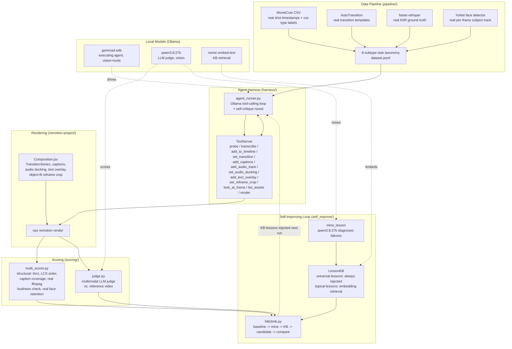

# RemotionBench

A benchmark and self-improving harness for **agentic video editing**: can an LLM, given raw
footage and a natural-language instruction, drive a real [Remotion](https://www.remotion.dev)
project through real tool calls to produce the video that was actually asked for?

Built as an open prototype for evaluating AI-controlled video editors (the target application
is a private product; this benchmark is deliberately built on fully open tooling and data so it
stands on its own). Every number in this repo comes from a real local run — a real Ollama model,
a real Remotion render, real ground truth pulled from public research datasets. Nothing here is
simulated.

## Why this exists

Existing video-generation benchmarks (VBench, EvalCrafter) score *diffusion models*, not
*editing agents* — they never touch tool calls, timelines, or an agent's process. Existing
editing-quality benchmarks (VE-Bench, VEFX-Bench, IVEBench) score *generative* video-to-video
editing (diffusion V2V models like Runway/Kling/VACE), not an agent driving a conventional NLE
tool. None of them measure the four things that actually determine whether an editing agent is
usable in production:

1. **Tool-call correctness** — did it call the right tools, in the right order, with valid arguments?
2. **Latency** — real wall-clock cost, per tool and end-to-end.
3. **Video quality** — does the rendered output hold up technically?
4. **Editing capacity** — did the output actually satisfy the instruction?

RemotionBench measures all four, end to end, against a task taxonomy grounded in real published
editing-craft datasets rather than synthetic prompts.

## Architecture



**The loop that actually runs**: pick a task → agent calls real tools against a real
`ToolServer` → `ToolServer` writes real Remotion inputs (`timeline.json`, `subtitles.json`,
`text_overlays.json`, `audio_tracks.json`) → `npx remotion render` produces a real `.mp4` →
score it (structural or LLM-judge, depending on subtype) → mine a lesson if something went
wrong → write it to a retrieval KB, classified as *universal* (tool-call mechanics, always
injected) or *topical* (a specific technique, retrieved by embedding similarity) → next run on
a similar task gets that lesson injected into its system prompt.

## The 8-subtype task taxonomy

| # | subtype | category | ground truth source | scoring |
|---|---|---|---|---|
| 1 | `scene_assembly` | generation | real MovieCuts shots + real reference cut | multimodal judge |
| 2 | `shot_ordering` | editing | MovieCuts chained shot sequence | structural (LCS order accuracy) |
| 3 | `cut_assembly` | editing | MovieCuts correct-next-shot + real cut-type label + real pulled distractors | structural |
| 4 | `caption` | editing | real `faster-whisper` ASR transcript | structural (coverage / dead-air) |
| 5 | `audio_mix` | editing | synthesized dialogue + music bed, real speech windows | structural (real `ffmpeg` loudness check) |
| 6 | `text_overlay` | editing | self-authored, exact expected args | structural |
| 7 | `reframe` | editing | real YuNet face-detector track on source footage | structural (re-run detector on actual cropped output) |
| 8 | `transition` | editing | AutoTransition real rendered template examples | multimodal judge (style, not content, reference) |

Every ground-truth video is either a real professionally-edited clip (MovieCuts/AutoTransition,
sourced from public YouTube movie-clip channels) or derived from real signal (ASR transcripts,
face detections) — nothing is hand-authored fiction.

### The "un-cut" technique

MovieCuts ships CSV rows of `(shot_left_start, shot_left_end, shot_right_start, shot_right_end,
cut_type_labels)` per annotated cut, not raw dailies. We reconstruct the raw-footage side
ourselves: chaining a movie's annotated rows by timestamp recovers its real shot-by-shot
decomposition (consecutive rows share a boundary shot), so a professionally edited sequence
becomes its own "raw material" once un-cut at the real cut points. Shots are extracted under
opaque hashed filenames (`clip_<hash>.mp4`) — not chronological indices — so an agent can't solve
ordering tasks by sorting filenames.

## Eval metrics, concretely

- **`sequence_order_accuracy`** — longest-common-subsequence ratio between predicted and real
  shot order (`scoring/multi_scorer.py::_lcs_ratio`).
- **`time_coverage`** — `min(d, d̂) / max(d, d̂)`, the exact formula from EditDuet (arXiv 2509.10761).
- **`repetitions`** — count of output sub-clip pairs with ≥80% temporal overlap, also from EditDuet.
- **caption coverage / dead-air rate** — fraction of real ASR speech intervals actually covered
  by an agent caption, and the inverse (captioning silence).
- **audio ducking** — real `ffmpeg volumedetect` mean dB during real speech windows vs. real
  silence windows in the *actual rendered audio*, not self-reported tool arguments.
- **`subject_retention_rate`** — re-runs the same YuNet face detector used to build ground truth
  on the agent's *actual rendered, cropped* output at matching timestamps.
- **multimodal judge** — `qwen3.8:27b` (vision) scores 1–4 per axis with a required rationale
  (VF-Eval-style structured feedback, not a bare scalar), comparing sampled frames.

## The self-improving harness

Grounded in three papers on harness self-improvement (see Citations):

1. **Weakness mining** — `qwen3.8:27b` reviews a failed trajectory + its scores and writes one
   concise, reusable lesson, classified as `universal` (tool-call sequencing — applies to any
   task) or `task_specific` (a technique mistake).
2. **Retrieval** — `nomic-embed-text` embeds lessons; universal lessons are always injected into
   the agent's system prompt regardless of similarity (a confirmed bug: pure cosine similarity
   ranked a universal "always populate the timeline before rendering" lesson **dead last**, 0.547,
   against a reframe task's instruction — it shares no vocabulary with "9:16 crop" even though
   it applies to every task).
3. **Self-critique** — after a successful render, the agent is shown a real frame from its own
   output (EditDuet's Editor/Critic pattern) and can keep working instead of always stopping at
   the first `render()` call.

## Real results (this session, `gemma4:e4b` as executing agent)

| task | before fixes | after fixes | root cause traced |
|---|---|---|---|
| `edit_cut_assembly_001` | ❌ refused (no way to see footage) | ✅ picked correct shot | added a real `look_at_frame` vision tool |
| `edit_transition_001` | ⚠️ fidelity 1/4 (judge penalized unrelated reference content) | ✅ 4/4 on all axes | fixed judge prompt to score execution, not content match |
| `gen_scene_assembly_001` | ❌ ran out of turns before rendering | ✅ rendered, judge 3/4 | raised turn budget |
| `edit_shot_ordering_001` (73 shots) | ❌ gave up after probing 15/73 | ✅ rendered, 62.5% order accuracy | vision tool + bulk `list_assets` |
| `edit_reframe_001` | ❌ scored 0% (broken CSS transform crop) | fixed crop confirmed visually (object-fit/object-position); agent reliability on this task is genuinely ~25% (1/4 trials) even after every fix | traced to a real harness bug (any `render()` call, success or failure, was ending the agent's loop) *and* a real, honestly-reported model reliability ceiling |

The reframe result is reported as a ceiling, not smoothed over: this benchmark's job is to find
where the real limit is, not to keep patching until every number looks good.

## Example harness outputs

Every file below is a real rendered `.mp4` from a real harness run, not a mock-up. Where a
model comparison exists, the failing model's row has no video because it genuinely never
reached `render()` — that absence is itself the result, not a missing upload.

| folder | what it shows | video | scores |
|---|---|---|---|
| `examples/caption_model_comparison/` | `llama3.1:8b` vs `gemma4:e4b` on the same caption task | `gemma_output_100pct_coverage.mp4` — real burned-in captions, synced to real ASR timing | `gemma_scores.json`: 100% speech coverage, 0% dead air. `llama_scores_never_rendered.json`: 0/10 captions — llama transcribed but never called `add_captions` |
| `examples/audio_mix_model_comparison/` | same comparison, ducking task | `gemma_output.mp4` — real mixed audio | `gemma_scores.json`: speech volume −22.28dB (up from −26.23dB baseline). `llama_scores_never_rendered.json`: never rendered |
| `examples/cut_assembly/` | agent chooses among real MovieCuts shots + real pulled distractors | `output.mp4` | `scores.json`: picked the correct shot, but also included a distractor (partial win, open scoring question) |
| `examples/shot_ordering/` | 73-shot reassembly stress test | `output.mp4` | `scores.json`: 62.5% order accuracy on the 9/73 shots it chose to place |
| `examples/scene_assembly/` | generation task: assemble 8 real shots vs. the real professional cut of the same footage | `output.mp4` (agent's render) vs `expected/reference.mp4` (the real original edit) | `scores.json`: multimodal judge — coherence 3/4, fidelity 3/4, technical 3/4 |
| `examples/transition_fixed_judge/` | transition applied between two real shots | `output.mp4` — a real cross-dissolve | `scores.json`: 4/4 on all three axes, after fixing the judge prompt that previously penalized unrelated reference content |
| `examples/reframe_crop_fix/` | verification that the object-fit/object-position crop fix actually works | `after_fix_frame.png` — single frame, subject correctly retained in a 9:16 crop | no bundled video: full multi-trial runs showed ~25% (1/4) end-to-end reliability on this task even after all fixes, and none of those trial runs were saved as bundles — reported as a number in the results table above, not smoothed into a cherry-picked clip |

## Repo layout

```
pipeline/         dataset builders — MovieCuts un-cutting, AutoTransition sampling,
                  ASR ground truth, YuNet face tracks, the 8-task taxonomy assembler
harness/          ToolServer (the real tool API), agent_runner.py (Ollama tool-calling
                  loop + self-critique), run_bundle.py (per-run artifact folder)
scoring/          metrics.py, task_scorer.py, multi_scorer.py — structural scorers
self_improve/     kb.py (retrieval KB), judge.py (multimodal LLM judge),
                  hillclimb.py (mine -> KB -> retrieve -> validate loop),
                  mine_weaknesses.py
remotion-project/ the actual Remotion composition (TransitionSeries, captions,
                  audio ducking, text overlays, reframe crop) -- Composition.jsx,
                  index.jsx, package.json
data/             dataset.jsonl (8 real tasks), lessons_kb.jsonl (mined lessons),
                  a small set of real sample assets
examples/         real input -> output pairs from actual harness runs, with scores.json
docs/             dashboard.html — a visual walkthrough of the pipeline and a
                  real reassembly-task run
```

## A note on paths

7 files under `pipeline/`, `harness/`, `scoring/`, `self_improve/` still have this development
session's scratch directory hardcoded as absolute path constants (e.g. `PILOT`, `DATASET_DIR`,
`RA` at the top of each file) rather than a config file or CLI args — carried over as-is from
where this was actually built and run, not cleaned up for portability yet. Before running
anything here, grep for `/tmp/claude` and repoint those constants at wherever you place the
data on your machine. This is the honest state of the repo, not a hidden gap.

## Reproducing a run

```bash
cd remotion-project && npm install         # pulls remotion, @remotion/transitions, etc.
ollama pull gemma4:e4b                      # executing agent (vision + tool calling)
ollama pull qwen3.8:27b                     # judge / lesson miner (vision)
ollama pull nomic-embed-text                # KB retrieval embeddings

python3 pipeline/build_dataset_v1.py        # rebuilds data/dataset_v1/dataset.jsonl
python3 self_improve/hillclimb.py           # runs baseline -> mine -> KB -> candidate
```

`harness/tool_server.py` is standalone and can be driven directly for debugging without an LLM
in the loop (see the smoke tests referenced in `docs/`).

## Data provenance & licensing

- **Code in this repo**: MIT.
- **MovieCuts** annotations: MIT-licensed (Pardo et al., ECCV 2022); source clips are drawn from
  publicly available YouTube movie-clip channels — used here for research/benchmark purposes,
  the same way the original MovieCuts/AVE/VE-Bench papers ship their own demo clips.
  `data/dataset_v1/sample_assets/` and `examples/` contain a small number of short clips for
  illustration, consistent with that precedent.
- **AutoTransition**: CC-BY-4.0 (Shen et al., ECCV 2022).
- All other sample data (dialogue transcripts, face tracks, synthesized audio) is derived
  locally from the above via `faster-whisper` and OpenCV's `FaceDetectorYN` (YuNet, OpenCV Zoo,
  Apache-2.0).

## Citations

Papers this benchmark's design is directly grounded in:

- Pardo, A. et al. **"MovieCuts: A New Dataset and Benchmark for Cut Type Recognition."** ECCV 2022. [arXiv:2109.05569](https://arxiv.org/abs/2109.05569)
- Shen, Y. et al. **"AutoTransition: Learning to Recommend Video Transition Effects."** ECCV 2022. [arXiv:2207.13479](https://arxiv.org/abs/2207.13479)
- Mur-Labadia, D. et al. **"The Anatomy of Video Editing: A Dataset and Benchmark Suite for AI-Assisted Video Editing."** ECCV 2022. [github.com/dawitmureja/AVE](https://github.com/dawitmureja/AVE)
- Li, B. et al. **"VEU-Bench: Towards Comprehensive Understanding of Video Editing."** CVPR 2025. [arXiv:2504.17828](https://arxiv.org/abs/2504.17828)
- Deng et al. **"VEBench: Benchmarking Large Multimodal Models for Real-World Video Editing."** CVPR 2026. [arXiv:2605.03276](https://arxiv.org/abs/2605.03276) — source of the Operation Simulation task design and the J-Cut/L-Cut/Jump-Cut/Smash-Cut/Cutaway/Match-Cut/Invisible-Cut taxonomy.
- Sun, S. et al. **"VE-Bench: Subjective-Aligned Benchmark Suite for Text-Driven Video Editing Quality Assessment."** AAAI 2025. [arXiv:2408.11481](https://arxiv.org/abs/2408.11481) — DOVER+BLIP scoring architecture reference.
- Gao, X. et al. **"VEFX-Bench"** — 3-axis (Instruction Following / Rendering Quality / Edit Exclusivity) rubric design reference, and the ordinal-regression reward-head architecture pattern. [arXiv:2604.16272](https://arxiv.org/abs/2604.16272)
- **EditDuet: A Multi-Agent System for Video Non-Linear Editing.** SIGGRAPH 2025. [arXiv:2509.10761](https://arxiv.org/abs/2509.10761) — Time Coverage / Repetitions / Failure Rate metrics, Editor/Critic self-verification pattern, EditStock evaluation methodology.
- **HELIX: Model-Harness Co-evolution for Recursive Self-Improvement.** [arXiv:2608.13951](https://arxiv.org/abs/2608.13951) — typed-ports/atoms/recipes harness decomposition.
- **Self-Harness: Harnesses That Improve Themselves.** [arXiv:2606.09498](https://arxiv.org/abs/2606.09498) — the Weakness Mining → Harness Proposal → Validation loop this benchmark's self-improve/ directory implements.
- **Evo-Bench: Can Language Models Improve Agent Harness?** [arXiv:2608.09096](https://arxiv.org/abs/2608.09096) — sensitivity-aware held-out splitting methodology for isolating real harness improvement from base-model strength (informs the "don't validate on the same task you mined from" caveat throughout this repo's run logs).
- Huang, Z. et al. **"VBench: Comprehensive Benchmark Suite for Video Generative Models."** CVPR 2024. [arXiv:2311.17982](https://arxiv.org/abs/2311.17982)
- Liu, Y. et al. **"EvalCrafter: Benchmarking and Evaluating Large Video Generation Models."** CVPR 2024. [arXiv:2310.11440](https://arxiv.org/abs/2310.11440)

## Known limitations

- `edit_cut_assembly_001`'s reference "picked correct shot" check doesn't yet penalize also
  including a distractor in the timeline — a real open scoring-policy question.
- `edit_shot_ordering_001` at 73-shot scale rewards partial/curated placement the same as full
  coverage; whether that's the right policy for a 73-asset task is undecided.
- `edit_transition_001` and `gen_scene_assembly_001` are judge-scored — cheaper and more
  flexible than structural checks, but inherit whatever biases the judge model has.
- Only `gemma4:e4b`, `qwen3.8:27b`, and `llama3.1:8b` were confirmed to reliably emit real tool
  calls against this Ollama install; `nemotron-mini` was tested and found not to (its chat
  template supports tool-call tags, but the 4.2B Q4 model doesn't reliably produce valid ones).
- `editing/transition`'s ground truth is 2 real AutoTransition example clips pulled cheaply from
  a 39GB archive (reading only the first tar entries) rather than the full labeled dataset —
  sufficient for a style reference, not for exact-label structural scoring.
